<div align="center">

# 🚆 Sepur Live

**Peta langsung, jadwal lengkap, dan perencana perjalanan kereta api Indonesia.**<br>
A live map, full timetables and a journey planner for Indonesian trains: KRL, MRT, LRT, airport rail, Whoosh and intercity trains across Java.

[](https://sepur-live.vercel.app)
[](https://github.com/podsni/sepur-live/actions/workflows/ci.yml)
[](LICENSE)
[](https://www.openstreetmap.org/copyright)
[](https://vercel.com)

[**Open the live map →**](https://sepur-live.vercel.app) · [Bahasa Indonesia](#-bahasa-indonesia) · [Data sources](#-data-sources--licences)

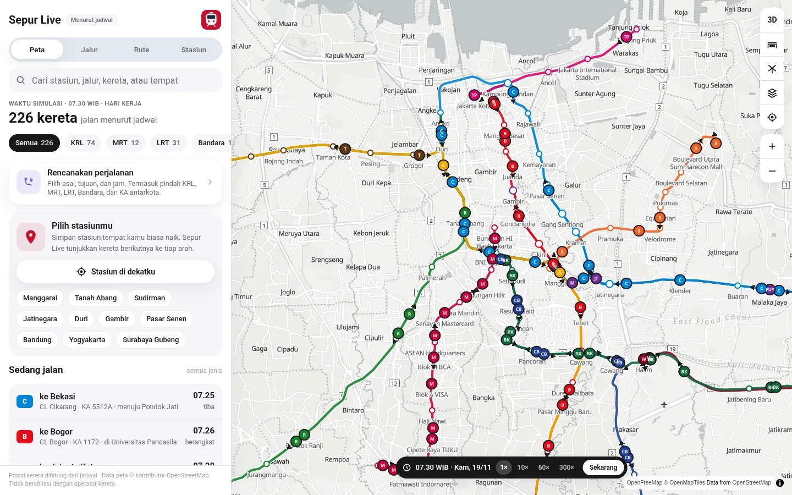

</div>

> [!IMPORTANT]
> **Every train on the map is computed from a timetable, not from GPS.** No open, real-time train positions exist for Indonesia, so Sepur Live moves each train along real OpenStreetMap track according to its planned times. Delays, cancellations and disruptions are **not** visible. The app says so on every screen ("Menurut jadwal"), and services whose timetable is not published are generated from frequency patterns and labelled **"Perkiraan"** (estimate). Speeds, KM positions and Daop of level crossings are estimates too, and are labelled as such.

## Contents

- [Feature tour](#-feature-tour)
- [Coverage: what is real and what is estimated](#-coverage-what-is-real-and-what-is-estimated)
- [How it works](#-how-it-works)
  - [Architecture](#architecture)
  - [Position and speed model](#position-and-speed-model)
  - [Journey planner (CSA)](#journey-planner-connection-scan-algorithm)
  - [Level-crossing (JPL) pipeline](#level-crossing-jpl-pipeline)
- [URL parameters and keyboard](#-url-parameters-and-keyboard)
- [Tech stack](#-tech-stack)
- [Project structure](#-project-structure)
- [Getting started](#-getting-started)
- [Testing](#-testing)
- [Performance](#-performance)
- [Accessibility](#-accessibility)
- [Known limitations](#-known-limitations)
- [Roadmap ideas](#-roadmap-ideas)
- [Contributing](#-contributing)
- [Data sources and licences](#-data-sources--licences)
- [Acknowledgements](#-acknowledgements)
- [License](#-license)
- [🇮🇩 Bahasa Indonesia](#-bahasa-indonesia)

## ✨ Feature tour

### Live map and animation

All trains that run according to the timetable are drawn on a MapLibre GL map (OpenFreeMap vector tiles) and **recomputed every animation frame** along OSM track geometry. They accelerate out of stations, brake into stops, wait at each stop, run at constant speed through stations they pass, and show a heading arrow rotated to the track. Zoom in to see train names on the map; hover (desktop) for name, destination and speed.

- Filter chips per system (KRL, MRT, LRT, Bandara, Whoosh, KA) with live counts.
- **Time travel**: any date and time (`#t=0730&d=2026-11-19`) with a time bar for 1× / 10× / 60× / 300× playback and "Sekarang" to return to now.
- 3D buildings, an underground view (tunnels dashed, map dimmed), "Lokasiku" (nearest stations), favourite station ("Stasiunku") and recent items.
- Search for stations, lines, intercity train names ("taksaka"), train numbers (`1000`, `KA 5`), crossing road names and places (Photon / OSM).

### Train card with photo and speed

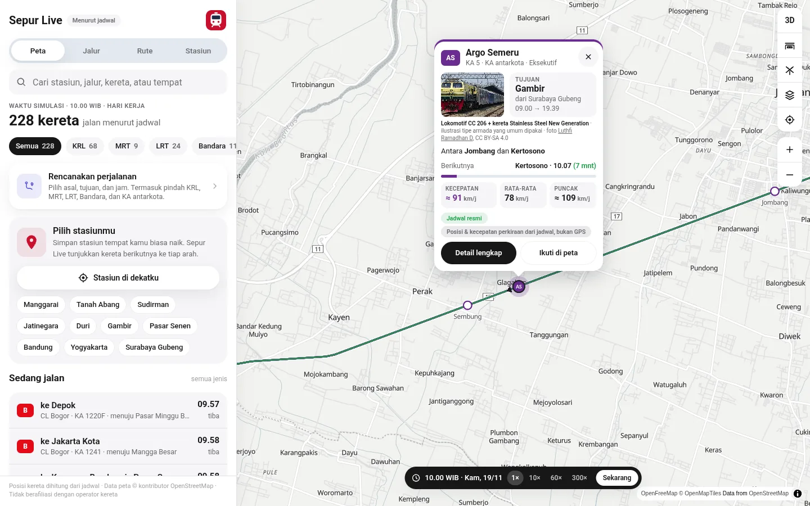

Tap or click a train to see its name and number, type and class, **destination ("Tujuan")** and origin, where it is now ("Antara Jombang dan Kertosono"), the next stop with a countdown, a progress bar, and the **estimated speed now**, trip average and estimated peak. A picture shows the **typical rolling stock** of that service (labelled *ilustrasi tipe armada yang umum dipakai*, because the exact unit on a trip is not public), with author and licence on the image. "Detail lengkap" opens the train page; "Ikuti di peta" keeps the map on the train.

### Train detail, prediction and speed chart

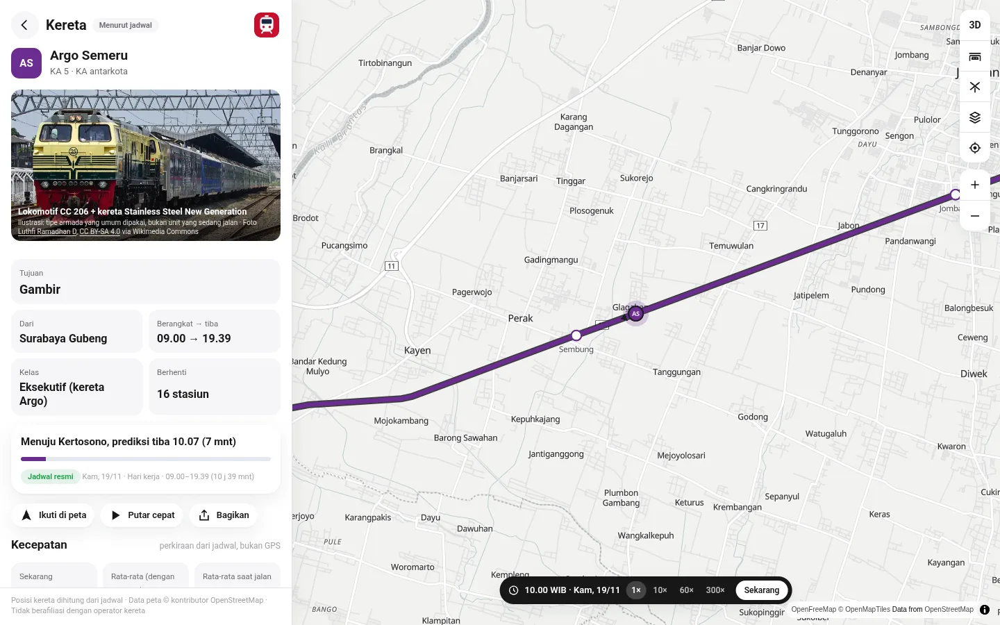

Live status with the predicted arrival at the next stop, every stop with arrival and departure and a countdown to each remaining stop, optional passing points for GAPEKA trains, track distance, average with and without stops, peak speed per section and a **speed chart** over the whole trip. "Putar cepat" replays the trip at 30× (120× for intercity).

### Journey planner (tab "Rute")

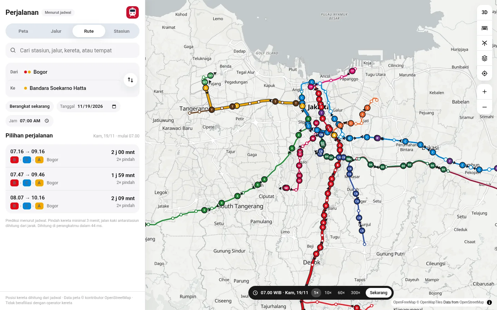

Choose origin and destination (type, or pick a station on the map), date and time, or "Berangkat sekarang". The planner searches **all timetables at once** (KRL, MRT, LRT, Skytrain, KA Bandara, Whoosh, KA Feeder, intercity and regional) and returns up to **5 non-dominated options** with departure, arrival, duration, transfers and waiting time. The journey page lists every leg and stop, draws the route in line colours, and **"Simulasikan"** plays the journey at 60× with the map following the running leg.

### Timetables: per station, per train, per line

| Station board and full-day timetable | Line timetable grid |
|---|---|
| 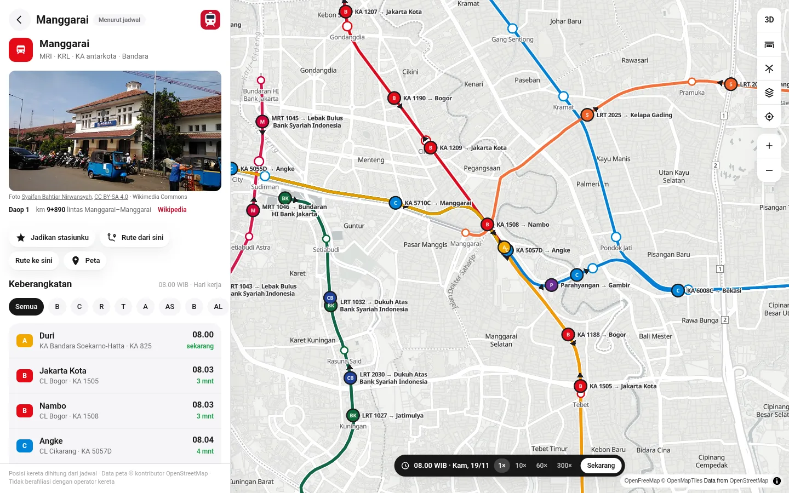 | 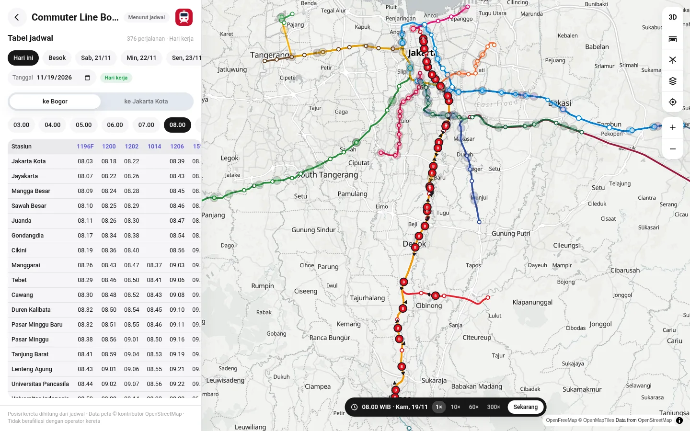 |

- **Station:** departures for the next 12 hours with countdowns, then **Jadwal lengkap sehari** (every train stopping that day, grouped by direction, filterable per line), a 7-day date strip and a date picker. Weekday, weekend and national-holiday timetables are picked automatically.
- **Line:** a grid of stations × trips for one direction, with direction toggle and date picker. `|` = passes without stopping, `~` = estimated time.
- **Train:** see above. Platform numbers are not shown anywhere, because no open source publishes them.

### Level crossings (JPL) with filters

| Crossing card with photo | Filters by status and Daop |
|---|---|
| 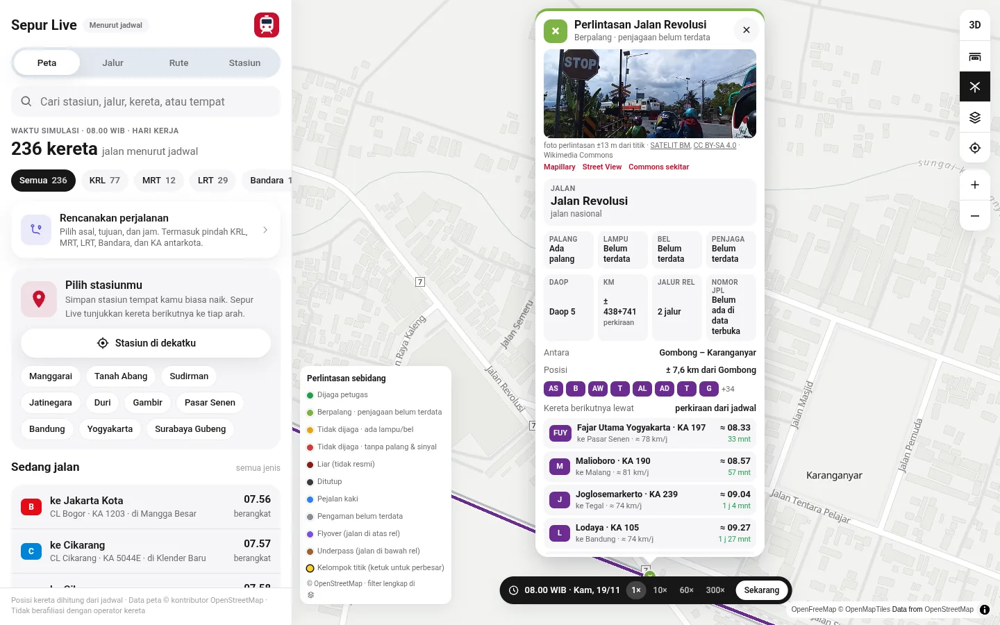 | 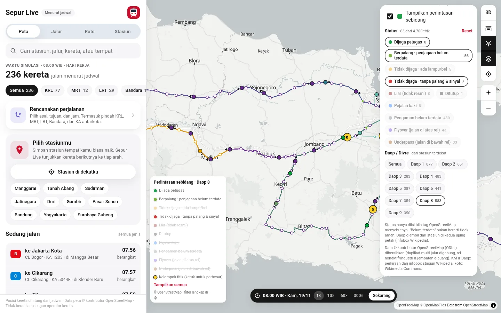 |

A **perlintasan sebidang** layer (off by default; × button or layers panel; saved and in the URL as `#jpl=1`) with **3,396 level crossings** and **1,304 grade separations** (409 flyovers, 895 underpasses) in Java, built from OpenStreetMap and cleaned (see [the pipeline](#level-crossing-jpl-pipeline)).

- Colours by status: *dijaga petugas*, *berpalang otomatis*, *berpalang · penjagaan belum terdata*, *tidak dijaga · ada lampu/bel*, *tidak dijaga · tanpa palang & sinyal*, *liar*, *ditutup*, *pejalan kaki*, *pengaman belum terdata*, *flyover*, *underpass*. Clusters below zoom 13.
- **Filters** by status (multi-select) and by **Daop/Divre** (chips in the layers panel, clickable legend on desktop), saved and in the URL (`#js=palang,jaga&jd=Daop8`).
- **Card:** photo (or "Belum ada foto" with Mapillary / Street View / Commons links), road and road class, barrier, light, bell, attendant, Daop, **KM estimate**, number of tracks, the two stations it lies between, routes over it, **next trains passing** with estimated time and speed, a data-completeness level (tinggi / sedang / rendah) and the source, plus a link to view or fix the point in OSM.
- JPL numbers and gatekeepers are **never invented**: "Nomor JPL" shows only an OSM `ref` tag (28 crossings), otherwise "Belum ada di data terbuka".

### Station photos

| Desktop: panel + popup | Mobile |
|---|---|
| 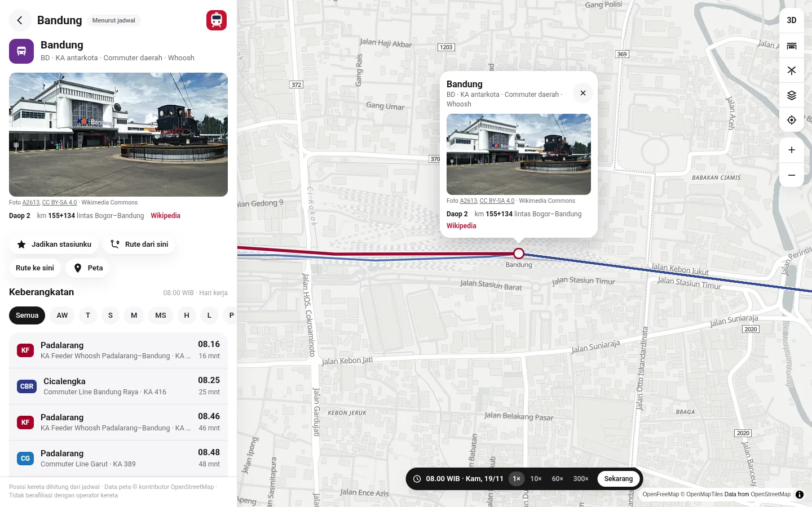 | 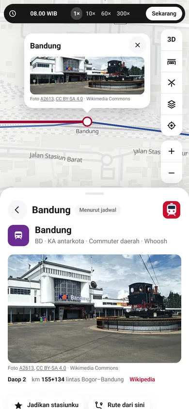 |

**448 of 483 stations (92.8 %)** have a photo from Wikimedia Commons (Wikidata P18), shown with author and licence in the station panel and in a popup when you tap a station, together with the Daop and km position from the station's Indonesian Wikipedia infobox.

### Responsive: phone, tablet, desktop

| Phone home | Phone train card |
|---|---|
| 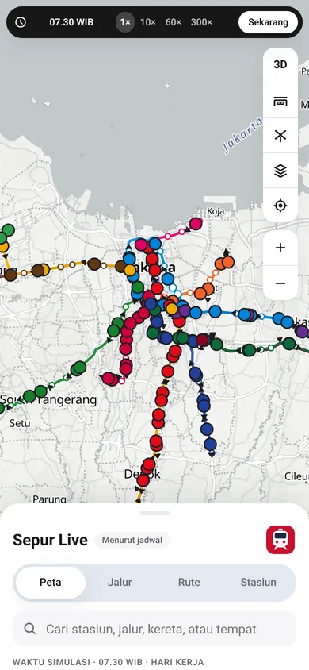 | 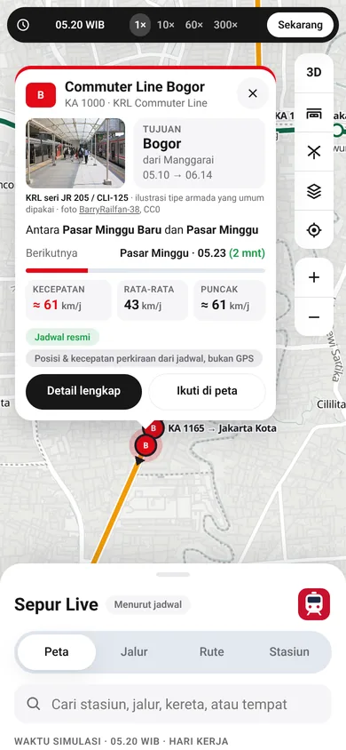 |

On phones the panel is a draggable bottom sheet (peek / half / full) and cards are placed so they are never hidden behind controls or the sheet; landscape and short screens get compact cards; chips and buttons grow to about 40 px on touch screens; safe-area insets are respected. Desktop uses a side panel. It installs as a PWA (web manifest) and shows a banner when offline.

## 📊 Coverage: what is real and what is estimated

| System | Lines | Trips in the data | Timetable source | Status |
|---|---:|---:|---|---|
| KRL Commuter Line (Bogor, Cikarang, Rangkasbitung, Tangerang, Tanjung Priok, Merak) | 6 | 1,143 weekday · 1,115 weekend | [Open-KRL](https://github.com/open-krl/pipeline) captures of public KAI Commuter station boards (CC BY 4.0; weekday 2026-10-12, weekend 2026-10-11) | ✅ Real planned times. Arrival = departure − 25 s dwell. |
| MRT Jakarta North–South | 1 | 285 weekday | [ShioriLabs commute](https://github.com/ShioriLabs/commute) (ODbL 1.0) | ✅ Weekdays real · ⚠️ weekends and holidays: frequency **estimate** |
| LRT Jabodebek (Cibubur, Bekasi) | 2 | 430 weekday · 270 weekend | ShioriLabs commute | ✅ Real departures |
| LRT Jakarta South | 1 | 167 daily | ShioriLabs commute | ✅ Real departures |
| Skytrain (Kalayang) Soekarno-Hatta | 1 | 166 daily | ShioriLabs commute | ✅ Real departures |
| KA Bandara Soekarno-Hatta | 1 | 140 daily | **GAPEKA 2026** | ✅ Real planned times |
| KA Feeder Whoosh Padalarang–Bandung | 1 | 72 daily | GAPEKA 2026 | ✅ Real planned times |
| Whoosh (KCIC Jakarta–Bandung) | 1 | generated at runtime | Operator's published frequency pattern | ⚠️ **Estimate** ("Perkiraan") |
| KA antarkota, commuter daerah, airport rail (Java) — `kai.json` | 107 (87 intercity, 18 regional, 2 airport) | 580 daily | **GAPEKA 2026** (KAI's working timetable), parsed with [Gapeka-parser](https://github.com/transportforbandung/Gapeka-parser) | ✅ Real planned times at stops. No day-of-operation field, so trains are assumed to run daily; *Fakultatif* services are flagged. Times at stations passed without stopping are estimates (`~`). |
| Track and stations | — | 483 stations, 494 sections | OpenStreetMap (ODbL), Geofabrik Java extract | 488 of 494 sections follow real track; the other 6 are drawn straight |
| Level crossings | — | 3,396 + 1,304 grade separations | OpenStreetMap + Wikipedia km/Daop + Commons photos | ⚠️ Volunteer-mapped; 2,770 crossings have no protection tags ("belum terdata" ≠ unprotected) |

Counts are taken from `public/data/*.json` as built (`trips.json`: weekday 1,858, weekend 1,385, daily 545 trips; `kai.json`: 107 lines, 580 daily trips).

## 🧠 How it works

### Architecture

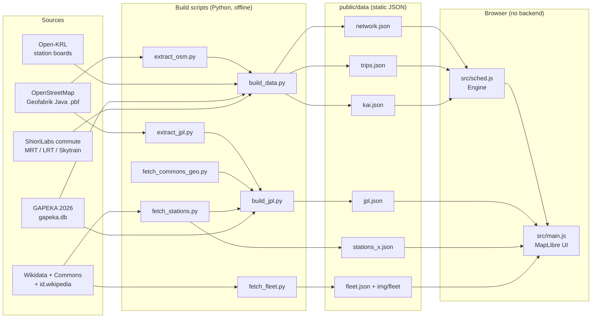

There is **no server**: Vercel serves `dist/` (esbuild bundle + `public/`) as static files. `network.json` and `trips.json` load first; `kai.json` (intercity) loads after first paint; `jpl.json` and `stations_x.json` load only when needed.

Track geometry: `build_data.py` routes each station-to-station section over the OSM rail graph with A\*, simplifies it (Ramer–Douglas–Peucker, 4 m) and stores it as `"A>B"` coordinate lists. Trips are packed as `[id, line, headsign, stations, dep[], arr[]|null, flags[]|null]` (flag bit 0 = stops, bit 1 = estimated time).

### Position and speed model

`src/sched.js` is pure (no DOM) and also runs in Node tests.

1. **Clock**: Asia/Jakarta (UTC+7) regardless of the device time zone; weekday / weekend (Saturday, Sunday, national holidays) picks the timetable.
2. **Smoothing**: timetables are rounded to whole minutes, so running time is redistributed by distance over windows of at least 10 minutes (`vtimes`), and urban dwell is capped at 40 s.
3. **Motion**: each section gets a **trapezoid profile** (accelerate, cruise, brake) with per-system acceleration (m/s²):

   | KRL | MRT | LRT Jakarta | LRT Jabodebek | Bandara | Whoosh | Regional | Intercity |
   |---:|---:|---:|---:|---:|---:|---:|---:|
   | 0.7 | 0.9 | 0.8 | 0.9 | 0.6 | 0.45 | 0.3 | 0.25 |

   Trains pass non-stop stations at speed. Displayed speeds are capped at the system's top service speed (KRL/MRT/Bandara 100, LRT Jakarta 70, LRT Jabodebek 90, regional/intercity 120, Whoosh 350 km/h).
4. **Position**: distance along the section → point on the OSM polyline → heading.

### Journey planner: Connection Scan Algorithm

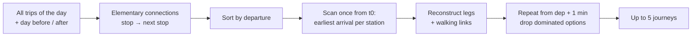

- Connections are built for the chosen day and its neighbours, so overnight trains work.
- Minimum change time at the same station: **3 minutes**; walking between linked stations at 1.1 m/s by distance; up to 5 transfers.
- Options that leave earlier and arrive later than another are removed (Pareto filter on departure / arrival).

### Level-crossing (JPL) pipeline

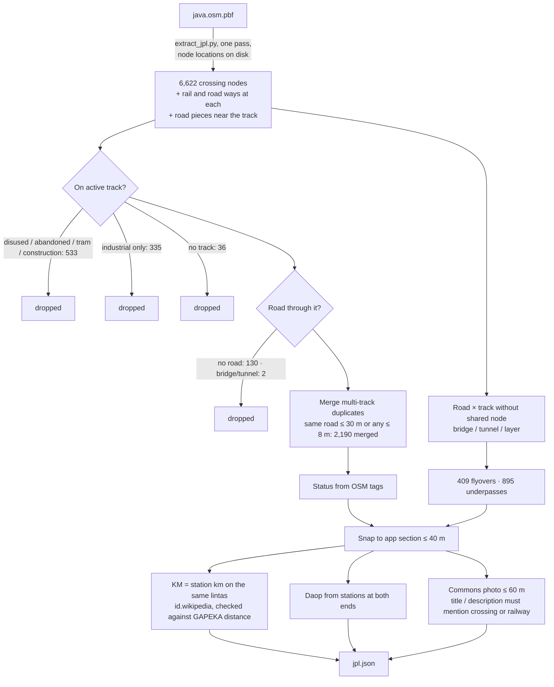

Status rules (closest equivalents of DJKA / 168railway categories, set **only** when tags say so):

| Status | OSM evidence | Count |
|---|---|---:|
| Dijaga petugas | `supervised=yes`, `crossing:supervision=attendant`, `crossing:activation=local/remote` | 26 |
| Berpalang otomatis | barrier + `crossing:activation=automatic` | 0 |
| Berpalang · penjagaan belum terdata | `crossing:barrier=*` | 279 |
| Tidak dijaga · ada lampu/bel | `crossing:light` / `crossing:bell`, no barrier | 25 |
| Tidak dijaga · tanpa palang & sinyal | `crossing:barrier=no`, `crossing=uncontrolled/unmarked` | 135 |
| Liar | `crossing=informal` | 5 |
| Ditutup | `disused:railway=level_crossing` or `access=no` | 8 |
| Pejalan kaki | `railway=crossing` | 148 |
| Pengaman belum terdata | none of the above | 2,770 |

Accuracy numbers (from `jpl.json` → `stats`, `clean`): 3,196 crossings snapped to an app section, 3,013 (89 %) with a KM estimate (e.g. Jalan Braga ≈ 155+884), 3,363 (99 %) with a Daop, 848 with a road name, 28 with an OSM `ref`; confidence high 240 / medium 994 / low 2,162. Crossing photos are rare: 26 level crossings and 10 grade separations have a suitable geotagged Commons photo.

## 🔗 URL parameters and keyboard

All state lives in the URL hash, so every view can be shared.

| Parameter | Example | Meaning |
|---|---|---|
| `station` | `#station=MRI` | Open a station (by code) |
| `line` | `#line=krl-b` | Open a line |
| `train`, `td` | `#train=1000&td=2026-11-19` | Open a train on a date |
| `tab` | `#tab=rute` | `jalur`, `stasiun` or `rute` |
| `from`, `to`, `pd`, `pt` | `#tab=rute&from=BOO&to=BST&pd=2026-11-19&pt=0700` | Journey planner query |
| `t`, `d`, `x` | `#t=0730&d=2026-11-19&x=60` | Time travel and playback speed |
| `jpl`, `js`, `jd` | `#jpl=1&js=palang,jaga&jd=Daop8` | Crossing layer, status filter, Daop filter |
| `@lat,lng,zoom` | `#@-6.2,106.83,12` | Map view |

Keyboard: **Esc** closes the open card, then the about sheet or the layers panel, cancels station picking, or goes back one view; **Enter** in the planner's station picker picks the first match.

## 🧰 Tech stack

| Part | Choice |
|---|---|
| Map | [MapLibre GL JS](https://maplibre.org) 5.24 with [OpenFreeMap](https://openfreemap.org) Positron vector tiles |
| App | Vanilla JavaScript (ES modules), no framework; one CSS file |
| Bundler | [esbuild](https://esbuild.github.io) 0.25 (`scripts/build.mjs`) |
| Geocoding | [Photon](https://photon.komoot.io) (komoot, OSM data) |
| Data pipeline | Python 3 + [pyosmium](https://osmcode.org/pyosmium/), SQLite (GAPEKA), Pillow (fleet images) |
| Tests | `node:test` (unit), [playwright-core](https://playwright.dev) + Chrome (headless smoke) |
| Hosting / CI | Vercel (static), GitHub Actions (`.github/workflows/ci.yml`: install, build, unit tests) |

## 📁 Project structure

```text
sepur-live/
├── index.html                 app shell: panel, map controls, time bar, sheets, SVG icons
├── src/
│   ├── main.js                UI: map layers, cards, planner, timetables, search, JPL, URL state, bottom sheet
│   ├── sched.js               engine: Jakarta clock, trips, positions, speed, boards, grids, CSA planner, passes
│   └── app.css                styles (responsive, touch, safe-area)
├── public/
│   ├── data/                  network.json, trips.json, kai.json, jpl.json, stations_x.json, fleet.json
│   ├── img/fleet/             10 rolling-stock photos (WebP, Commons licences)
│   ├── icon.svg, manifest.webmanifest
├── scripts/
│   ├── build.mjs              esbuild bundle + copy public/ → dist/
│   ├── serve.mjs              tiny static server with gzip (port 5173)
│   ├── extract_osm.py         OSM .pbf → railway ways, stations, route relations
│   ├── build_data.py          OSM + Open-KRL + GAPEKA + ShioriLabs → network/trips/kai.json
│   ├── extract_jpl.py         OSM .pbf → crossings, rail/road ways at them, road pieces near track
│   ├── fetch_stations.py      Wikidata/Commons photos + Wikipedia Daop/km → stations_x.json
│   ├── fetch_commons_geo.py   geotagged Commons files near crossings
│   ├── build_jpl.py           clean, merge, status, flyover/underpass, KM, Daop, photos → jpl.json
│   └── fetch_fleet.py         rolling-stock photos → public/img/fleet + ATTRIBUTION.md
├── tests/
│   ├── sched.test.js          18 unit tests (node:test)
│   └── smoke.mjs              57 headless browser checks
├── docs/screenshots/          images used in this README
├── test.sh                    build + unit + smoke against a local server
├── vercel.json                build settings and cache headers
├── ATTRIBUTION.md             photo credits and data licences
└── LICENSE                    MIT (code only)
```

## 🚀 Getting started

### Requirements

- Node.js 22 (as in CI) and npm
- For the smoke test: Google Chrome or Chromium and `playwright-core`
- Only to rebuild data: Python 3, `osmium` (pyosmium), `Pillow`, and disk space for the Java extract

### Install, run, build

```bash
git clone https://github.com/podsni/sepur-live.git
cd sepur-live
npm ci
npm run dev          # build + serve on http://localhost:5173
# or separately:
npm run build        # src/ + public/ -> dist/
npm run serve
```

Open `http://localhost:5173/#t=0730&d=2026-11-19` to see the weekday morning rush at any hour.

### Rebuild the data (optional)

The built JSON is committed, so this is only needed to refresh data.

```bash
# 1) OSM railways from the Geofabrik Java extract
curl -LO https://download.geofabrik.de/asia/indonesia/java-latest.osm.pbf
python3 scripts/extract_osm.py java-latest.osm.pbf raw/osm_rail.json

# 2) timetables
git clone --depth 1 https://github.com/open-krl/pipeline openkrl
curl -L -o raw/gapeka/gapeka.db https://github.com/transportforbandung/Gapeka-parser/raw/main/gapeka.db
# ShioriLabs commute timetable SQL + stations_lat_lng.sql into raw/shiori/

# 3) network, trips, intercity
python3 scripts/build_data.py --osm raw/osm_rail.json --krl openkrl --gapeka raw/gapeka/gapeka.db --shiori raw/shiori

# 4) station extras, then level crossings
python3 scripts/fetch_stations.py                                            # -> public/data/stations_x.json
python3 scripts/extract_jpl.py java-latest.osm.pbf raw/osm_rail.json raw/jpl_osm2.json
python3 scripts/fetch_commons_geo.py raw/jpl_osm2.json raw/commons_geo.json
python3 scripts/build_jpl.py raw/jpl_osm2.json                               # -> public/data/jpl.json

# 5) rolling-stock pictures
python3 scripts/fetch_fleet.py
```

`extract_jpl.py` reads the extract with node locations in an on-disk index (`sparse_file_array`) to keep memory low. The Wikidata/Commons scripts send a descriptive `User-Agent`, pause between requests and retry with back-off.

### Deploy to Vercel

The repo includes `vercel.json` (`npm ci` → `npm run build` → serve `dist/`, with cache headers for `/data/*`). Import the repo in Vercel with framework "Other", or run `vercel --prod`. No environment variables or server functions are needed.

## 🧪 Testing

```bash
sh ./test.sh         # build + unit tests + headless smoke test on a local server (port 5199)
npm test             # unit tests only
node tests/smoke.mjs https://sepur-live.vercel.app /tmp   # smoke test against any URL
```

- **18 unit tests** (`tests/sched.test.js`): Jakarta clock and day types; data has the expected systems and real timetables; KRL train 1000 matches its planned board times; Argo Semeru 5 leaves Surabaya Gubeng 09.00; rush-hour vs 02.30 counts; finite, continuous positions (no jumps > 200 m/s); station boards and full-day timetables; line grids; three planner journeys (Bogor → Bandara with a transfer, Jakarta → Surabaya, MRT → LRT); trapezoid profile covers the distance in the scheduled time; plausible speeds; next trains passing a crossing; JPL cleaning, statuses, KM/Daop and photo licences; station photos, Daop and km.
- **57 smoke checks** (`tests/smoke.mjs`, desktop 1400×900 and mobile 390×844): animation loop, home counts, station board and full timetable with date picker, train ETAs, line grid, source labels, search, planner, journey detail and simulation, train card with image and speed, JPL toggle / persistence / search / filters / photos / flyover card, station photo in panel and popup, night view, mobile sheet and cards on screen, and zero page errors.
- CI runs install, build and unit tests on every push to `main` and on pull requests.

## ⚡ Performance

- Positions are recomputed every frame, but only trains inside the viewport (plus a margin) are drawn. The frame rate adapts: capped at 60 fps, dropping to 30 when a frame costs > 8 ms and 15 when > 14 ms; 24 fps below zoom 9.5 and 6 fps below zoom 7.5, where movement is sub-pixel. Nothing is drawn while the tab is hidden.
- The list of active trips is refreshed once per second, not per frame.
- Gzipped data sizes: `network.json` 167 KB, `trips.json` 124 KB, `kai.json` 149 KB (after first paint), `jpl.json` 161 KB (only when the layer or a crossing search is used), `stations_x.json` 32 KB (on first station open).
- Fleet images are 640×360 WebP (460 KB for all 10). Station and crossing photos are 500 px Commons thumbnails, lazy-loaded.
- Crossing "next trains" use a per-day index of trips per section plus bisection on the motion profile.
- `vercel.json` caches `/data/*` for an hour with `stale-while-revalidate`.

## ♿ Accessibility

- Buttons and controls have `aria-label`s; tabs use `role="tab"` with `aria-selected`; toggles use `aria-pressed`; cards are `role="dialog"`.
- Esc closes cards and panels; browser back works between views.
- Touch targets grow to about 40–48 px on coarse pointers; `prefers-reduced-motion` disables transitions and animations in the UI.
- Status is never colour-only: crossing and train cards spell out their status in text. Light colour scheme only for now.

## 🚧 Known limitations

- **No GPS / real-time data.** Delays, cancellations and extra trains are invisible.
- **Whoosh** and **MRT weekends/holidays** are frequency estimates.
- GAPEKA has **no day-of-operation**; all intercity trains are assumed to run daily (*Fakultatif* flagged).
- **No platform numbers** (not in any open source).
- Rolling-stock photos show the typical type, not the unit on that trip.
- Java only; Sumatra and other islands are not covered.
- **Level crossings:** official JPL numbers, gatekeeper (KAI / Dishub / swadaya), EWS status and survey details (rail, sleepers) are not open data; 2,770 crossings have no protection tags in OSM; only 26 crossings have a photo; KM and Daop are estimates. Government portals listing JPLs (DJKA e-Perlintasan, SIMARLIN Lumajang, SIMINFRA Grobogan) state no reuse licence and are not imported.
- 6 of 494 track sections are straight lines where OSM routing found no path.

## 🧭 Roadmap ideas

- Real-time positions if KAI / KAI Commuter ever publish an open feed (GTFS-Realtime).
- Day-of-operation for intercity trains from an open source.
- Sumatra (Divre I–IV) networks and timetables.
- Dark mode, more languages.
- Contribute missing crossing tags back to OpenStreetMap (barrier, light, supervision) and photos to Wikimedia Commons, which flow into the next data build.

## 🤝 Contributing

Issues and pull requests are welcome.

1. Fork and create a branch.
2. `npm ci && sh ./test.sh` — keep unit tests and smoke checks green.
3. Keep data honest: anything estimated must be labelled in the UI; never add data without a licence that allows reuse.
4. For data fixes, prefer fixing the source (OpenStreetMap, Wikidata, Commons) and rebuilding.

## 📚 Data sources & licences

Full credits are in [ATTRIBUTION.md](ATTRIBUTION.md).

| Data | Source | Licence |
|---|---|---|
| Track, stations, level crossings | © [OpenStreetMap](https://www.openstreetmap.org/copyright) contributors, [Geofabrik](https://download.geofabrik.de/asia/indonesia.html) Java extract | ODbL 1.0 (`network.json`, `jpl.json` are derived databases) |
| KRL timetables | [Open-KRL](https://github.com/open-krl/pipeline) | CC BY 4.0 |
| Intercity, regional, KA Bandara, Feeder | GAPEKA 2026 (KAI), via [Gapeka-parser](https://github.com/transportforbandung/Gapeka-parser) | timetable facts by KAI; parser used as a tool |
| MRT, LRT, Skytrain | [ShioriLabs commute](https://github.com/ShioriLabs/commute) | ODbL 1.0 |
| Station photo links | [Wikidata](https://www.wikidata.org) (P18) | CC0 |
| Station Daop and km | [id.wikipedia.org](https://id.wikipedia.org) station infoboxes | CC BY-SA 4.0 |
| Station, crossing and fleet photos | [Wikimedia Commons](https://commons.wikimedia.org) | per file (CC BY-SA, CC BY, CC0, GFDL, public domain), author and licence shown next to each photo |
| Base map | [OpenFreeMap](https://openfreemap.org) / OpenMapTiles | OSM data ODbL; see OpenFreeMap terms |
| Place search | [Photon](https://photon.komoot.io) by komoot | OSM data ODbL |

**Photos are not MIT.** Each keeps its own Commons licence and author. The fleet images in `public/img/fleet/` were cropped to 16:9, resized and converted to WebP.

## 🙏 Acknowledgements

- [trafik.live](https://trafik.live) for the interaction design that inspired the layout. Sepur Live is an independent re-implementation with its own code, name, icons and data pipeline; no code or data from trafik.live is used.
- [168railway](https://168railway.com/jpl) for showing what a useful level-crossing map looks like. Their survey database is not openly licensed and is **not** used.
- OpenStreetMap mappers, Open-KRL, Transport for Bandung (Gapeka-parser), ShioriLabs, Wikidata, Wikipedia and Wikimedia Commons contributors.

Sepur Live is not affiliated with KAI, KAI Commuter, MRT Jakarta, LRT Jakarta, KCIC, InJourney or any operator.

## 📄 License

Code: [MIT](LICENSE) © 2026 Hendra Bangun Dwi R. Data and photos keep the licences of their sources (see above and [ATTRIBUTION.md](ATTRIBUTION.md)).

---

## 🇮🇩 Bahasa Indonesia

**Sepur Live** adalah peta langsung, jadwal lengkap, dan perencana perjalanan kereta api Indonesia: KRL Commuter Line, MRT Jakarta, LRT Jakarta, LRT Jabodebek, KA Bandara Soekarno-Hatta dan Skytrain, Whoosh dan KA Feeder, serta KA antarkota dan commuter daerah di Pulau Jawa. Buka di **[sepur-live.vercel.app](https://sepur-live.vercel.app)**.

> [!IMPORTANT]
> **Posisi kereta dihitung dari jadwal, bukan GPS.** Data posisi kereta real-time tidak tersedia untuk publik, jadi setiap kereta digerakkan di atas rel OpenStreetMap sesuai jadwalnya. Keterlambatan dan pembatalan tidak terlihat. Layanan yang jadwal resminya belum terbit (Whoosh, MRT akhir pekan) dibuat dari pola frekuensi dan diberi label **"Perkiraan"**. Kecepatan, posisi KM, dan Daop perlintasan juga perkiraan dan ditandai begitu.

### Fitur

- **Peta langsung dan animasi.** Kereta bergerak halus di atas rel, mempercepat saat berangkat, mengerem saat masuk stasiun, berhenti, lalu jalan lagi, dengan panah arah. Ada filter per sistem, mesin waktu (`#t=0730&d=2026-11-19`) dengan pemutaran 1×–300×, tampilan 3D dan bawah tanah, Lokasiku, Stasiunku, dan pencarian (stasiun, jalur, nama dan nomor kereta, nama jalan perlintasan, tempat).
- **Kartu kereta.** Klik kereta untuk melihat nama, nomor, tujuan dan asal, posisinya sekarang, stasiun berikutnya dengan hitung mundur, **perkiraan kecepatan** (sekarang, rata-rata, puncak), dan foto tipe armada yang umum dipakai (ilustrasi, dengan kredit dan lisensi).
- **Detail kereta.** Status langsung, daftar berhenti dengan hitung mundur, jarak tempuh, grafik kecepatan sepanjang perjalanan, dan "Putar cepat".
- **Perencana perjalanan (tab Rute).** Pilih asal, tujuan, tanggal, dan jam. Rute dicari dari semua jadwal sekaligus dengan Connection Scan Algorithm, dengan waktu pindah minimal 3 menit dan jalan kaki antarstasiun yang terhubung. Hasilnya sampai 5 pilihan dan bisa disimulasikan di peta.
- **Jadwal lengkap.** Papan keberangkatan dan jadwal sehari per stasiun (dengan pilihan tanggal; hari kerja, akhir pekan, dan libur nasional otomatis), tabel jadwal per jalur, dan daftar berhenti per kereta. Nomor peron tidak ditampilkan karena tidak ada di sumber data terbuka mana pun.
- **Perlintasan sebidang (JPL).** Lapisan yang bisa dimunculkan atau disembunyikan, berisi **3.396 perlintasan sebidang** dan **1.304 flyover/underpass** di Jawa. Datanya dibersihkan dari OSM: titik di rel mati, rel industri, titik tanpa jalan, dan titik di jembatan dibuang, dan titik ganda per jalur digabung. Status mengikuti istilah DJKA/168railway bila tag OSM mendukung (dijaga, berpalang, tidak dijaga, liar, ditutup, pejalan kaki, belum terdata, flyover, underpass). Ada **filter per status dan per Daop**. Kartu perlintasan berisi foto (atau "Belum ada foto" dengan tautan Mapillary/Street View), jalan, pengaman, Daop, **perkiraan KM**, jumlah jalur rel, stasiun di kedua sisi, perkiraan kereta yang lewat berikutnya, tingkat kelengkapan data, dan sumbernya. Nomor JPL dan penjaga **tidak pernah dikarang**.
- **Foto stasiun.** **448 dari 483 stasiun (92,8%)** punya foto dari Wikimedia Commons (lewat Wikidata) dengan nama pembuat dan lisensi, di panel stasiun dan di popup saat stasiun diketuk, plus Daop dan km dari infobox Wikipedia.
- **Responsif.** Di HP panelnya berupa lembar bawah yang bisa ditarik, kartu selalu muat di layar, tombol besar untuk layar sentuh. Di desktop panelnya di samping. Bisa dipasang sebagai PWA.

### Cakupan data

| Sistem | Sumber | Status |
|---|---|---|
| KRL (6 lin, 1.143 perjalanan hari kerja) | Open-KRL (CC BY 4.0) | Jadwal resmi |
| KA antarkota, regional, KA Bandara (107 layanan, 580 perjalanan/hari) | GAPEKA 2026 | Jadwal resmi; hari operasi dianggap setiap hari |
| MRT Jakarta | ShioriLabs (ODbL) | Hari kerja resmi; akhir pekan perkiraan |
| LRT Jakarta, LRT Jabodebek, Skytrain | ShioriLabs (ODbL) | Jadwal resmi; tiba di stasiun akhir ditaksir |
| Whoosh | Pola frekuensi | Perkiraan |
| Rel, stasiun, perlintasan | OpenStreetMap (ODbL) | 488 dari 494 petak mengikuti rel asli |

### Cara kerja singkat

Skrip Python mengolah OpenStreetMap, Open-KRL, GAPEKA, ShioriLabs, Wikidata, dan Wikimedia Commons menjadi berkas JSON statis. Di browser, `src/sched.js` menghitung posisi setiap kereta dari jadwal dengan profil kecepatan trapesium (percepatan per sistem, misalnya KRL 0,7 m/s² dan KA antarkota 0,25 m/s²), lalu `src/main.js` menggambarnya di peta MapLibre. Tidak ada server: situsnya berupa berkas statis di Vercel.

### Menjalankan sendiri

```bash
git clone https://github.com/podsni/sepur-live.git
cd sepur-live
npm ci
npm run dev            # http://localhost:5173
sh ./test.sh           # build + 18 uji unit + 57 uji browser
```

Langkah membangun ulang data ada di bagian [Rebuild the data](#rebuild-the-data-optional).

### Keterbatasan

Tanpa GPS dan data real-time; Whoosh dan MRT akhir pekan masih perkiraan; hari operasi KA antarkota tidak tercantum di GAPEKA; tanpa nomor peron; hanya Pulau Jawa. Untuk JPL: nomor resmi, penjaga (KAI/Dishub/swadaya), status EWS, dan data survei tidak tersedia sebagai data terbuka; 2.770 perlintasan belum punya keterangan pengaman di OSM; baru 26 perlintasan yang punya foto. Portal pemerintah (DJKA e-Perlintasan, SIMARLIN Lumajang, SIMINFRA Grobogan) tidak mencantumkan lisensi pemakaian ulang, dan data 168railway tidak dipakai.

### Lisensi dan kredit

Kode: MIT © 2026 Hendra Bangun Dwi R. Data dan foto mengikuti lisensi sumbernya (OpenStreetMap ODbL, Open-KRL CC BY 4.0, ShioriLabs ODbL, Wikipedia CC BY-SA 4.0, Wikidata CC0, foto Commons sesuai lisensi masing-masing). **Foto tidak berlisensi MIT.** Rincian lengkap di [ATTRIBUTION.md](ATTRIBUTION.md). Terinspirasi tampilan trafik.live dan peta JPL 168railway, tanpa memakai kode atau data mereka. Tidak berafiliasi dengan KAI, KAI Commuter, MRT Jakarta, LRT Jakarta, KCIC, atau InJourney.
